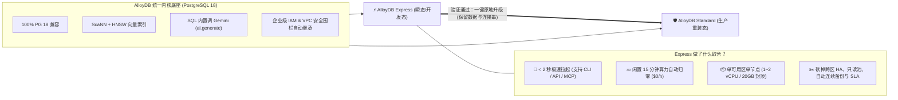
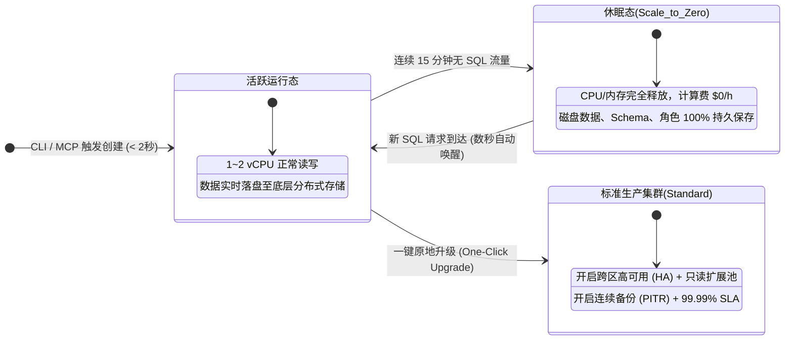
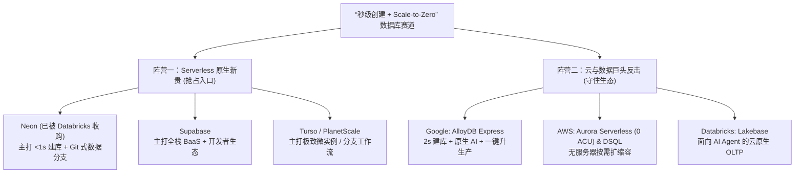
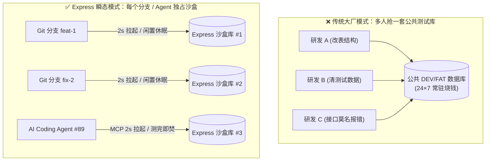
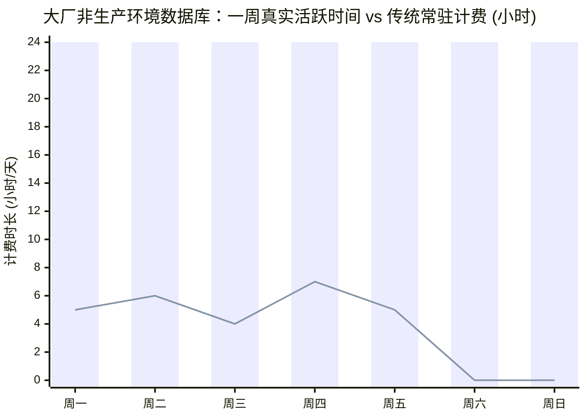
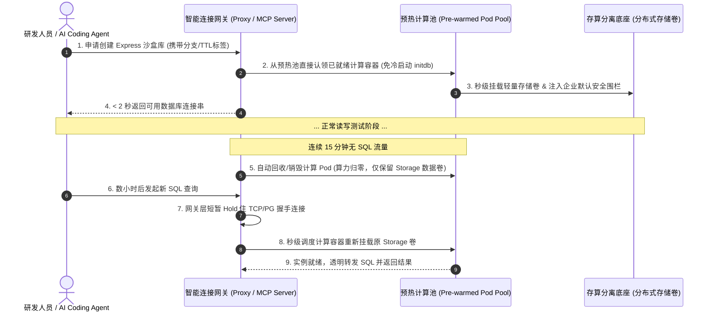

Title: 2 秒建库、闲置归零：从 Google AlloyDB Express 聊聊“瞬态数据库”到底是不是伪命题？
Date: 2026-11-08 22:15:00
Tags: database, postgresql, serverless, alloydb, ai-infra, google-cloud
Slug: alloydb-express-transient-database
Author: 小生说大声讲
Summary: 最近 Google 为其王牌数据库 AlloyDB 推出了轻量形态 AlloyDB Express：2 秒建库、15 分钟闲置算力归零、保留 100% 内核并支持一键原地升配生产。这表面上是一个轻量测试库，背后其实是面向 AI Coding Agent 与企业研发环境隔离的“瞬态数据库”范式转移。本文深入聊聊它的取舍设计、赛道格局与企业内部 DB 基建启示。
Mermaid: true

> **写在前面**：最近翻 Google Cloud 的官方博客，看到他们给自家的王牌数据库 AlloyDB 推出了一个叫 **AlloyDB Express** 的新形态。说实话，刚看完前两段介绍时，我脑子里冒出了好几个问号：这不就是把高可用和备份砍了的“缩水版”吗？和火了好几年的 Supabase、Neon 有啥区别？如果是独立开发者（OPC）图便宜省事用用还行，在大型企业内部，这种数据库到底有什么存在的必要？
>
> 顺着这几个最初没想通的问题一路扒下去，我发现自己之前低估了这件事——它表面上是一个轻量级测试库，背后其实是 AI 时代研发链路和企业数据库基建（DB Infra）的一次底层逻辑切换。把这几天的调研和思考整理成这篇笔记，跟大家聊聊。

---

## 一、 先看东西：Google 到底端出了个什么物种？

如果你平时用 PostgreSQL，应该听说过 **AlloyDB**——它是 Google Cloud 对标 AWS Aurora 的当家旗舰，主打存算分离、高性能，还塞进了 Google 自研的 `ScaNN` 向量索引和原生大模型调用能力。

但标准版 AlloyDB 有个老毛病：**太重、太慢、太贵**。拉起一个标准集群动辄十几分钟，哪怕一条 SQL 都不跑，常驻算力每个月也要烧掉大几百美金。

这次发布的 **AlloyDB Express**，本质上不是一个新写的数据库引擎，而是对 AlloyDB 做了一次极其激进的**“外科手术式裁剪”**——保留了 100% 的内核与 AI 能力，但把所有面向生产容灾的笨重装甲全卸了：

把官方文档的细节抠出来，它的核心指标就四条：
1. **快到离谱**：通过公网 DNS 端点 **2 秒内**就能拉起一个可用的 PG 18 实例（私网 PSC 约 20 秒），除了常规的 CLI 和 Terraform，还专门提供了 **MCP（Model Context Protocol）** 接口给 AI Coding Agent 直接调。
2. **不干活不给钱**：连续 **15 分钟**没有查询，计算节点自动休眠，休眠期算力费用是 **`$0`**；下次有 SQL 进来，几秒钟自动唤醒。
3. **规格封顶**：只有 1 vCPU（4GB 内存）或 2 vCPU（8GB 内存）两档，存储死卡在 **20 GB 上限**。
4. **随时“转正”**：原型跑通了，点一下按钮就能**原地单向升级**成标准版生产集群，不用导数据、不用改表结构、连应用的数据库连接串都不用换。

---

## 二、 第一个疑问：没有备份和高可用，这种“半吊子持久化”真有人需要吗？

看到 Express 砍掉了自动连续备份（PITR）、砍掉了跨可用区高可用（HA）、也不提供 SLA 承诺时，我的第一反应是：**一个在持久化和可靠性上打折扣的数据库，真的有实用价值吗？**

但仔细核对了它的存储机制后，我发现自己一开始混淆了两个概念：**“数据落盘持久化（Storage Persistence）”** 和 **“生产级容灾保险（HA / DR / Backup）”**。

AlloyDB Express **并不是内存数据库，也不是用完即焚的临时容器**。它的生命周期是这样的：

换句话说，当它休眠时，你写进去的 5GB 向量数据、建好的表结构，一字节都不会丢，全都在底层分布式磁盘上躺着；只是一旦单机房物理故障它不会自动主备切换，或者你手抖 `DROP TABLE` 了没有平台自动快照帮你兜底。

想明白这层区别后，就会发现这种 **“落盘不丢数据 + 砍掉常驻容灾算力”** 的设计，恰恰卡在了研发流程里最舒服的黄金生态位上：

| 方案形态 | 代表产品 | 启动速度 | 闲置成本 | 数据是否持久保留 | 内核与生产一致性 | 转生产摩擦 |
| :--- | :--- | :--- | :--- | :--- | :--- | :--- |
| **本地玩具态** | 本地 Docker PG / SQLite | 秒级 | `$0` | ❌ 容器删了就没 / 仅限单机 | ❌ 缺云端专有插件与 IAM | 极高（需重搭环境、迁数据） |
| **黄金中间态** | **AlloyDB Express / Neon** | **< 2 秒** | **算力 `$0`** | **✅ 云端落盘保留** | **✅ 100% 生产同款内核** | **零摩擦（一键原地升配）** |
| **生产重装态** | AlloyDB Standard / Aurora | 5~15 分钟 | 极高（24h 常驻） | ✅ 11 个 9 持久 + 连续备份 | ✅ 生产环境本身 | 无 |

如果完全不持久化，团队花两周调通的 AI Demo、灌进去的测试知识库，关机就没了；但如果一上来就按生产标准配齐双机热备和连续日志备份，为了一个每天只跑半小时的测试库付全额保险费，又纯粹是冤大头。

---

## 三、 第二个疑问：这跟 Supabase 有啥区别？还有谁在卷这个赛道？

既然聊到了“快速拉起一个 Postgres”，很多人第一反应肯定是 **Supabase**。我当时也顺手对比了一下：Google 搞这么个东西，是不是在抄 Supabase 的作业？

把底层拆开来看，两者虽然都在讨好开发者，但**产品基因和终点完全不在一条线上**：

### 1. Supabase vs AlloyDB Express —— 全栈脚手架 vs 企业内核入口

| 维度 | Supabase | AlloyDB Express |
| :--- | :--- | :--- |
| **本质定位** | **开源版 Firebase（全栈 BaaS 平台）** 目标是让前端/独立开发者少写甚至不写后端代码。 | **企业级数据库的“Serverless 轻量入口”** 纯粹的数据库底座，让你用白菜价用上 Google 魔改内核。 |
| **附赠全家桶** | 自带 Auth 登录、自动生成 REST/GraphQL API、Realtime 订阅、Edge Functions、对象存储。 | 只管数据库本身，但深度打通了 Google Vertex AI / Gemini 模型调用与企业 IAM。 |
| **架构天花板** | 底层是跑在云主机上的标准开源 PG。业务真长到几十 TB、数万并发时，会遇到传统单主 PG 的扩展瓶颈。 | 底层是存算分离的 AlloyDB。一键升级后直通百核、列存加速、多节点只读池的企业级集群，**没有扩展天花板**。 |
| **休眠体验** | 免费版闲置 1 周暂停（本质是关停 VM），唤醒往往要等 **1~3 分钟**。 | 真正的瞬态 Serverless：**15 分钟无流量即休眠**，新请求到达**数秒内唤醒**。 |

### 2. 谁才是真正的假想敌？—— 全球 Serverless 数据库战局

如果看清了技术脉络，你会发现 **AlloyDB Express 真正贴身肉搏的对手其实不是 Supabase，而是 Neon（以及收购了 Neon 的 Databricks）**。

* **Neon（已被 Databricks 以约 10 亿美元收购，孵化出 Lakebase）**：这个赛道的真正开创者。最早把 PG 存算分离做到 `< 1 秒` 建库、Scale-to-Zero，还做出了杀手级特性 **Database Branching（像 Git 拉分支一样，1 秒零拷贝克隆出生产库的测试分支）**。据披露，Neon 上 **超过 80% 的数据库实例都是由 AI Agent 自动创建的**。
* **Turso / Prisma Postgres**：在 SQLite（libSQL）和轻量 PG 赛道把微实例做到毫秒级拉起、按请求计费。
* **AWS Aurora Serverless v2 & DSQL**：AWS 同样意识到了危机，不仅给 Aurora Serverless 重新加回了 `0 ACU（缩容至零）`，还推出了全无服务器的 Aurora DSQL。

为什么云大厂突然全在卷“2 秒建库”？道理其实很残酷：**谁掌握了开发者写下第一行代码（以及 AI Agent 创建第一个沙盒）时的默认数据库，谁就掌握了未来生产环境高价值负载的入口。** 如果任由开发者在原型期全跑到 Neon 和 Supabase 上，等项目做大了，没人愿意再迁回笨重的传统云数据库。

---

## 四、 核心困惑：OPC 用它很爽，但大型企业内部要它干嘛？

聊到这儿，我心里最大的一个疙瘩还是没解开：

> **“如果是 OPC（One-Person Company，一人公司 / 独立开发者），没钱又没专职运维，这种平时不花钱、上线一键转正的数据库简直是神器。但在一家拥有几百上千名工程师的大型企业内部，公司不差那点预算，又有现成的测试环境和 DBA，这种轻量数据库在大厂里到底有什么用？”**

带着这个问题，我把大型企业内部真实的研发链路、安全管控和云账单翻出来算了一笔账，结果发现：**大企业对这种数据库的渴求，可能比 OPC 还要强烈得多。** 因为大厂有 4 个靠传统重型数据库根本解不开的死结：

### 1. 终结“几十号人抢一个 FAT 库”的环境污染灾难
在绝大多数大企业里，因为申请一个标准数据库实例又慢又贵，往往是一个研发团队（20~50 人）共用一套 `DEV` 库和一套 `FAT/SIT` 联调库。
这导致每天都在上演熟悉的戏码：老王为了测自己的新分支，在公共库里跑了个 `ALTER TABLE` 改了字段，或者清空了某张配置表；正在联调的隔壁小李接口瞬间全挂，排查一通宵才发现是别人动了公共库。

为什么以前不给每个研发、每个 Git 分支配一个独立数据库？因为 1000 个研发每人开 3 个分支就是 3000 个常驻实例，机器预算直接爆炸。而有了 **2 秒拉起 + 15 分钟闲置归零** 的能力，大企业第一次可以低成本实现 **Per-Branch / Per-PR 级别的环境隔离**：

### 2. 本地 Docker 跑不通大厂的“云端专有特性”
你可能会问：跑 CI/CD 自动化测试，直接在流水线里起一个免费的本地 PostgreSQL Docker 容器（比如 Testcontainers）不就完事了？
在简单项目里确实够用，但在深度上云的大企业里会撞墙：**生产代码往往用到了企业云数据库的专有能力**——比如 AlloyDB 独有的 `ScaNN` 向量索引、SQL 内嵌的 `ai.generate()` 模型调用、或者企业级 GCP IAM 角色认证。标准开源的 PG Docker 镜像里根本没有这些东西！
用 Express，每次跑 CI 流水线花 **2 秒** 拉起一个 **100% 生产同款内核** 的云端真实例，跑完 3 分钟集成测试直接销毁，成本不到一分钱，却彻底消除了开发与生产环境的割裂。

### 3. 给大厂内部的“影子 IT（Shadow IT）”和 AI 试错开一个合规出口
现在所有大企业都在逼各个部门搞 AI 创新：HR 部门想搞个简历筛选助手，法务想做个合同比对 RAG，加上各条业务线无数的内部运营小工具。
这些项目 **90% 只是内部 PoC（概念验证）**，可能试两周就黄了。如果走大厂正规的 DBA 审批和预算流程去申请高可用数据库，流程能卡半个月；结果就是研发人员嫌烦，偷偷拿个人邮箱去公网上注册免费的 Supabase 把公司数据传上去测——这就是让所有大厂 CISO（首席安全官）头皮发麻的 **Shadow IT**。

AlloyDB Express 最聪明的一点就是 **“自动继承企业组织 IAM 与 VPC 安全围栏”**：研发体验像个人免费版一样 2 秒自助到手，但数据牢牢锁死在公司内网和审计围栏里。100 个内部试错项目死掉 98 个几乎不花钱，活下来的 2 个点一下按钮直接转成标准生产库。

### 4. 支撑大厂后台成千上万个 AI Coding Agent 并行干活 + 砍掉 40% 僵尸账单
OPC 平时最多开一两个 AI 编程窗口；但一家拥有 5000 名工程师的大企业，内网后台可能同时跑着 **上万个自主编程 Agent（Autonomous Coding Agents）**。
每个 Agent 领了一个修 Bug 的工单，自己拉起数据库改表、塞数据、跑通自测，然后提 PR 等待人类工程师 Code Review。人类工程师可能开完会 **6 个小时后** 才来看这个 PR。

更别提大厂现有的非生产环境（Dev / QA / Staging）本身就是个巨大的吞金兽。如果我们把大厂一个测试数据库**一周 168 小时**的真实负载画出来，就能明白为什么 FinOps 团队看到 `Scale-to-Zero` 会两眼放光：

> **账单真相**：在上面这张图里，柱状图（每天 24 小时满额）是传统企业级测试库付的钱；而折线图（每天仅工作时段断续活跃 4~7 小时，周末为 0）是真实的 SQL 运行时间。**大厂非生产环境往往吃掉了公司 30%~50% 的数据库预算，但其中超过 75% 的算力都在空转烧钱。**

---

## 五、 写在最后：如果我们在企业内部做 DB 基建，能抄什么作业？

聊透了这些，其实不管我们自己公司用不用 Google Cloud，AlloyDB Express 展现出的产品设计思路，对所有在企业内部做 **数据库基础设施（DB Infra / RDS 平台）** 的团队都是一个非常清晰的信号。

以前内部 DB 平台的核心指标是 **“稳”**（几个 9 的高可用、主从切换多快、备份多全）；但在 AI Agent 和敏捷开发时代，内部研发团队会对 DB 平台提出一套全新的诉求：**能不能 2 秒给我一个库？能不能按分支隔离？不用的时候能不能别扣我部门预算？**

如果要在企业内部的私有云 / K8s 底座上自研类似的能力，有四件事现在就可以开始琢磨：

1. **打破“一套重型模板走天下”的惯性**：在内部 DB 平台上明确拆出 `Express（瞬态沙盒态）` 和 `Standard（生产高可用态）`。沙盒态大胆砍掉跨机房同步和重型备份，换取极致的速度与密度；同时基于底层统一存储卷，打通“不改连接串原地升配生产”的通道。
2. **用“预热池（Warm Pool）+ 智能网关”实现秒级供给与休眠**：现拉 K8s Pod 再跑 `initdb` 绝对进不了 2 秒。核心是在后台常备一个轻量预热池；同时在客户端和 DB 之间加一层代理网关——闲置时摘掉计算 Pod，有新连接进来时网关先 Hold 住握手，后台秒级唤醒容器挂载存储，对应用层做到无感唤醒。
3. **把 AI Agent 当作 DB 平台的一等公民用户**：以前做内部平台是给“人”画前端工单页面；接下来必须给内部平台加上 **MCP Server** 和声明式 API，支持带着 `TTL（生命周期自动回收标签）` 创建数据库。
4. **用“预设安全围栏”代替“人工审批工单”**：把网络隔离域、单库 20GB 硬上限、统一鉴权策略固化到沙盒模板里。只要在安全围栏内的轻量库申请，全部免 DBA 审批秒级放行。

---

**一点感触**：
过去十年，云原生数据库上半场卷的是**“上限有多高”**——分布式事务、PB 级存储、百万级 QPS；而以 Neon、AlloyDB Express 为代表的下半场，大家突然调转枪头开始卷**“下限有多轻”**——能不能 2 秒拉起、能不能缩容到 0、能不能让 AI Agent 随手拿来当草稿纸用。

当数据库从一个需要打报告申请的“重资产”，变成像本地文件一样随开随用、还能随时长成参天大树的“瞬态基础设施”时，研发的玩法确实要变了。
